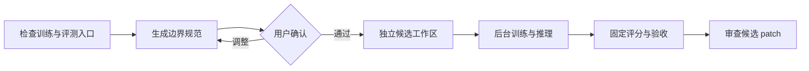

# Model Iteration Skills

让 agent 在用户确认的范围、固定评测和明确预算内迭代模型；保留现有训练框架，只有显式晋级才改动主代码。

[English](README.md) · **简体中文**

[](https://github.com/yuanxiang02/model-iteration-skills/actions/workflows/tests.yml)

> **v0.5.0，本地优先的 Codex 插件与受控迭代。** 核心 skill 引导 Codex，`mih` 执行内核落实实验门禁并导入逐项校验哈希的 agent 轨迹。调研、查新和多 agent review 是可选辅助模块。参见[控制机制](docs/controllability.md)与[平台边界](#支持平台与边界)。

**开发预览：基于 dsh CLI 的文件对齐与探索树。** `mih explore` 读取实际项目文件，
生成代码与数据边界草案供用户讨论，并从 Git 历史及有来源的指标记录建立节点。
本地界面支持主指标高度、从下向上的谱系、代码 diff、关键节点 review、分支关闭与
启用/禁用，以及 Markdown/JSON 节点文档。可通过外部 dsh CLI 插件接续只读讨论。
详见[操作、演示与验证说明](docs/exploration-harness.md)。该预览覆盖解耦评估和研究交接，
真实训练仍使用独立确认的实验协议。

已完成的 runtime 实验现在可以通过校验证据的 `explore attach-run` 进入探索树。参见
[可信实验闭环](docs/trusted-experiment-closure.md)与[两类验证场景](docs/validation/trusted-closure-2026-11-11.md)。
真实 agent/RSI 历史也可以通过隐私安全、逐 artifact 校验哈希的
`explore import-trajectory` 进入归档层。[`subspace_cem` 真实 pilot](docs/real-agent-trajectory.md)
保留了一次失败启动、修复、12 个运行、聚合 verdict 和停止决策，但不会把历史 GPU 记录
冒充成 mih 已经重跑并验收的 trusted run。

### 作为 Codex 插件安装

本仓库现在是自包含的 Codex 插件 marketplace；本地 checkout 不需要 Python
打包、API key、远端算力或托管服务即可安装：

```bash
codex plugin marketplace add /absolute/path/to/model-iteration-skills
codex plugin add model-iteration-harness@mih-open-source
```

新开 Codex session 后使用 `$model-iteration`。skill 会通过插件缓存内的
`skills/model-iteration/scripts/mih.py` 调用 runtime，状态和实验输出仍留在本地。
本机安装、缓存调用及新 session 发现验证见
[Codex 插件验证报告](docs/validation/codex-plugin-2026-11-11.md)。

核心 runtime 不绑定任何模型 API。若明确选择 DeepSeek，可使用可选的
[DSH headless 适配器](skills/model-iteration/references/deepseek.md)执行原生 agent
验证任务；它保留 provider/session 证据，并且失败时不会回退到 Codex。

## 把哪些事情控制住

| 问题 | 控制方式 |
|---|---|
| Agent 能改哪里？ | 用户确认的允许/禁止路径，固定 baseline，保存候选 patch |
| Agent 能重新定义“好结果”吗？ | 固定评分、数据、种子和验收规则，使用独立评分结果 |
| 最多探索到什么程度？ | 确认候选总数和活动候选上限；默认一轮，通过开发验收即停止 |
| 长训练会不会一直跑？ | 单命令和整个实验的时限、取消与恢复机制 |
| 结果还能追溯吗？ | 独立工作区、声明的变量、实际改动、失败记录与证据 |
| 什么时候影响主代码？ | 通过验收后，针对已评测 baseline 单独显式晋级 |

核心流程是 **检查项目 → 确认控制规范 → 隔离候选 → 后台执行 → 固定评测 → 停止或显式晋级**。
不要求先做调研、查新或多 agent review。这些控制有明确的运行时权限边界，不代表已经隔离
拥有宿主无限制权限的 agent，也不代表开发阶段统计结论已经得到独立确认。

## 在 Codex 中使用核心 skill

```bash
git clone https://github.com/yuanxiang02/model-iteration-skills.git
cd model-iteration-skills
python3 scripts/install_skills.py
```

默认只安装 `$model-iteration`，路径为 `$CODEX_HOME/skills`，未设置时使用 `~/.codex/skills`。
同名目录不会被覆盖；可用 `--dest /path/to/skills` 选择新目录。实际运行实验还需安装下文的执行内核。
按宿主需要刷新 skill 列表后，直接对话：

```text
用 $model-iteration 接入当前训练项目。计划最多探索 3 个候选，同一时间只保留 1 个活动候选，
获得首个通过开发验收的候选就停止。固定评测与数据划分。
先展示允许/禁止修改范围、时间预算和完整边界规范，等我确认后再开始。
```

Agent 会生成 `BOUNDARIES.md` 及确切的规范摘要，不能代用户批准。变更协议或更新耗尽的预算，
都要重新生成并确认规范；默认草案只允许一个候选。

### 查看与中断探索

```bash
mih --state STATE project controls PROJECT_ID
mih --state STATE project pause PROJECT_ID --reason "继续运行前先审查"
mih --state STATE cancel EXP_ID
mih --state STATE project resume PROJECT_ID --reason "操作者允许继续"
```

暂停阻止新建候选、新启动和晋级，已运行的任务会继续，除非单独取消。恢复不会返还预算，
也不会批准规范。失败或取消的候选保留证据，并占用已预留的总名额。
整个实验时限覆盖基线/候选的训练、推理和评分；详见[控制语义与兼容边界](docs/controllability.md)。

## 解决什么问题

Agent 能修改训练代码，但一次可信的实验还需要稳定的评测、清晰的结果归属、可恢复的执行状态和明确的验收规则。

执行内核在现有训练程序外管理这些环节：

- 为基线和候选建立独立 Git worktree。
- 在项目迭代前，与用户核对允许修改、禁止修改、数据/评测、种子和预算。
- 用独立后台 worker 运行训练，以及可选的 checkpoint 推理。
- 使用冻结的 evaluator 计算指标，不采信训练 stdout 自报的成绩。
- 保存 patch、日志、产物、失败记录，以及接受、拒绝或不确定的结论。
- 通过单独、显式的晋级操作，才把候选 patch 应用到原项目。

核心框架不要求重写 Trainer，也不依赖 LLM API key。Codex 等 coding agent 可以按附带的 skill，通过 shell 工具调用 CLI。内置模型 API 客户端和自动唤醒 agent 的能力尚未实现。

## 三阶段流程

| 阶段 | 命令 | 产出 |
|---|---|---|
| **1．解耦评估** | `mih project inspect` | 入口观察和拆分方案；不自动重构，也不把静态观察当作评测独立性证明 |
| **2．边界确认** | `mih project draft`、`compare-split`、`approve` | 版本化 `spec.json`、可阅读的 `BOUNDARIES.md`，以及对确切规范的显式确认记录 |
| **3．开始迭代** | `mih iterate`、`submit`、`report`、`promote` | 绑定已确认协议、独立运行的候选实验 |



在同一个 state 中，已登记项目尚未确认规范，或规范发生改变时，迭代会被阻止。Agent 不得代用户自批。

## 安装实验执行内核

需要 Git、POSIX 系统和 Python 3.9+。示例套件建议使用 Python 3.10+，因为固定版本的 SimpleBayes 库要求该版本。PyTorch 是可选依赖；运行语言模型示例时，需要已有的 PyTorch 安装。

```bash
git clone https://github.com/yuanxiang02/model-iteration-skills.git
cd model-iteration-skills
python3 -m venv .venv
source .venv/bin/activate
python -m pip install -e .
mih --version
mih --help
```

核心没有第三方运行时依赖。请从本仓库安装；上述步骤不依赖已发布的 PyPI 包。下文命令均假设当前目录是仓库根目录，且虚拟环境已经激活。

## 先跑一个轻量实验

```bash
# 标量神经网络：标准库 + 固定版本的 micrograd 源码。
python examples/run_lightweight.py --task micrograd

# 微型文本分类：请用 Python 3.10+ 运行此准备脚本。
python examples/run_lightweight.py --task simplebayes

# CPU 文本 GRU：训练 -> checkpoint 推理 -> 独立评分。
python examples/run_lightweight.py --task torch-lm
```

这些命令通过底层 runner 运行手动 smoke 实验，用于了解实验生命周期。正式接入用户项目时，继续使用下面的“规范确认后迭代”流程。

准备脚本只下载少量固定 commit、校验 SHA-256 的源码与许可证，使用微型构造数据，结果保留在 `.mih-demo/`。它不会下载 PyTorch、申请算力或调用模型 API。

在 Linux 上运行可信示例时，请显式追加 `--isolation trusted-local`。`auto` 在 macOS 选择本地子进程沙箱；没有对应后端的平台会直接报错，不会静默降低限制。

PyTorch 示例会探测已有解释器。也可以明确指定：

```bash
python examples/run_lightweight.py --task torch-lm \
  --torch-python /path/to/python-with-torch \
  --torch-python-path /path/to/its/site-packages
```

在已记录的 Mac 上，micrograd 和文本分类各用数秒。用户确认规范后的 PyTorch 迭代使用 **568 个参数、CPU 单线程、5 组配对种子，耗时约 44 秒，子进程峰值 RSS 约 271 MiB**。内存主要由框架导入占用，不是模型权重大小。这些是实测记录，不是性能承诺，详见[验证记录](docs/validation/README.md)。

## 完整走一遍规范确认流程

先准备 micrograd 项目，不启动训练。Harness state 必须放在训练仓库之外；下面的目录布局已满足这一点。

```bash
python examples/run_lightweight.py --task micrograd \
  --root .mih-demo-reviewed --prepare-only

mih --state .mih-demo-reviewed/state project inspect \
  .mih-demo-reviewed/projects/micrograd \
  --train train.py --eval "$PWD/src/mih/scoring.py"
```

命令返回 JSON。下面的 `PROJECT_ID`、`SPEC_DIGEST`、`EXP_ID` 需要替换为你实际得到的值；`CANDIDATE_WORKSPACE` 指返回的候选目录。这些名称都是占位符。

重复演练时使用新的 `--root`，或明确通过 `project inspect --refresh` 重新评估已有项目。Refresh 会保留历史，并使之前的批准失效。

### 1．阅读解耦方案

查看生成的 `DECOUPLING.md` 和 `analysis` 输出。评估结果可能是 `split-required`、`separate-entrypoints` 或 `uncertain`。

如果训练与评分共用可修改代码，需要明确冻结的评分入口，以及 checkpoint 推理或预测导出接口。拆分时保留原有训练行为和 checkpoint 选择规则。静态分析本身不能证明数据流独立或整个流程行为等价。

### 2．生成规范，与用户确认

```bash
mih --state .mih-demo-reviewed/state project draft PROJECT_ID \
  .mih-demo-reviewed/micrograd-contract.json \
  --protect vendor/ --protect upstream.json

mih --state .mih-demo-reviewed/state project status PROJECT_ID
```

打开返回的 `boundaries` 和 `specification` 路径。与用户核对：允许/禁止修改的文件、固定评测输入与参考答案、评分程序、环境、预算、种子和验收规则。显式禁止路径优先于允许目录。

如果评估要求拆分，批准前需要对同一批输入的拆分前后预测做比较：

```bash
mih --state .mih-demo-reviewed/state project compare-split PROJECT_ID \
  --before /path/to/original-predictions.jsonl \
  --after /path/to/separated-predictions.jsonl
```

用户确认确切规范之后，操作人再记录批准：

```bash
mih --state .mih-demo-reviewed/state project approve PROJECT_ID \
  --digest SPEC_DIGEST --reviewer "your-name"
```

Agent 不得自行批准。`reviewer` 是本地确认记录，不是经过认证的人类身份。预测比较只检查提供的记录，不能证明这些记录的执行来源或整个训练流程等价。

### 3．创建一个候选并运行

```bash
mih --state .mih-demo-reviewed/state iterate PROJECT_ID \
  --hypothesis "Increase SGD steps from 1 to 40 with the same model and data" \
  --factor "steps: 1 -> 40"
```

在 **`CANDIDATE_WORKSPACE/settings.json`** 中，把 `{"steps": 1}` 改为 `{"steps": 40}`。修改返回的候选目录，保留原始项目。也可以通过 `iterate --patch /path/to/change.patch` 提交已有 patch。

```bash
mih --state .mih-demo-reviewed/state submit EXP_ID
mih --state .mih-demo-reviewed/state status EXP_ID
mih --state .mih-demo-reviewed/state wait EXP_ID --timeout 60
mih --state .mih-demo-reviewed/state report EXP_ID
```

`submit` 启动独立后台 worker 后返回；当前 agent turn 结束也不影响训练继续。`wait` 是普通 Python 等待，不调用模型；等待时间到达后，也可能返回尚未终止的状态。`status` 输出简短，`report` 包含详细证据。

增加训练步数不保证候选通过验收。应如实处理 `accepted`、`rejected` 和 `inconclusive`。如果通过，先检查可晋级的 patch：

```bash
mih --state .mih-demo-reviewed/state promote EXP_ID
```

审查后，如需明确应用：

```bash
mih --state .mih-demo-reviewed/state promote EXP_ID --apply
```

这会把 patch 应用到**原始训练仓库，并保留为未提交改动**，不会自动 commit、push 或合并。目标仓库必须仍然干净，且 baseline 与评测时相同。当前原型中，修改已提交基线或固定协议，需要重新生成规范并确认。

## 如何接入已有训练框架

保留现有 PyTorch、Lightning、Trainer 或自定义训练循环，声明其命令与产物接口。必要时增加薄包装，导出预测或适配已有评测入口。

下面展示可被 v1 接受的合同结构。使用前需要按实际脚本替换路径和参数；它不是任意仓库都能原样运行的配置。

```json
{
  "schema_version": 1,
  "hypothesis": "One declared model change improves the fixed development metric.",
  "source": {
    "repository": "/path/to/training-repository",
    "baseline": "HEAD",
    "allowed_paths": ["model/", "train.py", "config/"],
    "protected_paths": ["eval.py", "metrics/"]
  },
  "training": {
    "argv": ["/path/to/python", "train.py", "--output-dir", "{output}", "--seed", "{seed}"],
    "inference_argv": ["/path/to/python", "integration/export_predictions.py", "--checkpoint", "{output}/checkpoint.pt", "--inputs", "{inputs}", "--output", "{predictions}"],
    "inputs": "/path/to/evaluation-inputs.jsonl"
  },
  "evaluation": {
    "reference": "/path/to/reference.jsonl",
    "metric": "accuracy",
    "direction": "maximize"
  },
  "execution": {"isolation": "auto", "timeout_seconds": 20, "total_timeout_seconds": 120},
  "acceptance": {
    "scope": "development",
    "seeds": [11, 22, 33, 44, 55],
    "confidence": 0.95,
    "minimum_effect": 0.0,
    "bootstrap_samples": 2000
  }
}
```

目前 `training.inputs` 字段指预测/评测输入文件，而非整个训练数据集；训练数据仍由原训练程序处理。参考答案必须位于候选源码仓库之外。Checkpoint、日志和预测应写入 `{output}`，避免写进源码 worktree。

默认 scorer 支持 accuracy 和下一 token 的 NLL，使用 ID 严格匹配的 JSONL。自定义 `evaluation.evaluator` 需要是可信、独立的 Python 脚本，接受 `--predictions`、`--reference`、`--metric`、`--output` 参数。它在 harness 的 Python 环境中以隔离导入方式运行；需要的可信评分依赖应安装在该环境。训练可以使用自己的解释器，并明确声明 `training.python_paths`。

允许/禁止范围按文件或目录前缀匹配，不支持 glob。命令是 argv 数组，不是 shell 字符串。占位符、预测格式、预算和自定义 evaluator 的完整要求见[运行合同说明](docs/runtime.md#working-contract-v1)。

## 如何让 coding agent 使用

向 agent 提供项目 ID、state 根目录和 [Agent 操作规范](docs/agent-workflow.md)。例如：

> 用 harness 检查这个项目，提出必要的训练/评分拆分，再生成边界规范供我审查，不要代我批准。确认后，每次围绕一个假设创建候选，只修改允许的路径，提交一次实验，并审查记录下来的结果。训练期间结束模型 turn。不要修改 evaluator，也不要在未经授权时应用晋级 patch。

Agent、人和脚本使用同一套 JSON CLI。任务状态落盘之后，另一个 agent session 可以根据 ID 接续，无需依赖旧对话记忆。

## 查看证据与恢复

| 命令 | 用途 |
|---|---|
| `mih validate contract.json` | 校验并解析合同，不启动训练 |
| `mih --state STATE list` | 列出实验状态 |
| `mih --state STATE status EXP_ID` | 查看简短当前状态 |
| `mih --state STATE report EXP_ID` | 查看指标、日志/产物引用和验收结果 |
| `mih --state STATE recover EXP_ID` | 核对已记录的 worker/job，恢复尚未执行的排队提交意图 |
| `mih --state STATE cancel EXP_ID` | 请求取消 |

如果 worker 丢失，但记录中的子进程仍在运行，实验会标记为 `orphaned`，不会静默重复训练。中断实验不会自动重试。

```text
STATE/
  projects/PROJECT_ID/      # 分析、规范版本、确认记录
  runs/EXP_ID/              # 冻结合同/scorer、patch、日志、评分、验收
  workspaces/EXP_ID/        # 基线与候选源码
  outputs/EXP_ID/           # 按角色和种子分组的 checkpoint、预测
```

失败和不确定的实验也会保留。Harness 不会把本地数据集、checkpoint 或清理操作自动推送到 GitHub。

## 支持平台与边界

| 范围 | 当前支持 |
|---|---|
| macOS | 独立本地任务，使用 `sandbox-exec` 约束候选子进程 |
| Linux | 显式选择 `trusted-local` 运行可信代码；尚无强制 Linux 沙箱 |
| Windows | 尚不支持 |
| 训练接入 | 本地命令、可选的独立推理、小型产物/预测接口 |
| 验收 | 仅开发阶段的配对种子 percentile bootstrap |
| Agent 接入 | 通过已有 shell 工具调用 JSON CLI |

调用方 agent 本身没有被自动隔离。拥有同一用户无限制权限的进程，或另一个 state 根目录，不在本地确认门禁的权限边界内。macOS 后端也不会隐藏所有宿主文件，不构成生产级安全保证。

实验运行时仍有面向小示例的文件和预算限制，尚无完整依赖环境快照、远程/Slurm 执行、任意执行谱系、自动推进 baseline、自动唤醒 agent 或 MCP server。开发预览增加了本地研究图界面及显式 dsh 讨论派发。通用非劣效和多目标验收尚未实现。

当前上限：预测输入、参考答案和 evaluator 文件各不超过 10 MiB；受监控的输出预算默认 10 MiB，最多可设为 100 MiB；每条命令超时可设为 1～3,600 秒，整个实验时限为 1～86,400 秒。这些控制并不构成严格的总内存/总算力限制；较大的训练项目仍需要后续后端与产物管理支持。

开发阶段 bootstrap 区间不解决小样本校准、自适应选优、重复检验或评测样本不确定性。开发验收通过，不代表已经确认泛化收益。详见[统计边界](docs/runtime.md#statistical-boundary)。

## 可选研究辅助模块

调研和审查帮助选择候选，不授予执行权限，也不替代实验验收。若需要，向新目标目录安装完整四个 skill：

```bash
python3 scripts/install_skills.py --with-addons
```

| 辅助 skill | 用途 | 主要产出 |
|---|---|---|
| `$mi-research` | 结合代码、论文和仓库调研可实现方案 | 候选方案与证伪实验 |
| `$mi-novelty` | 对研究贡献主张核查最接近的先例 | 逐项重合分析与检索局限 |
| `$mi-review` | 获得授权且工具可用时，独立审查方法与完整性 | 原始审查、问题与分歧 |

这些模块使用 `request.json → result.json + 带哈希的证据` 交接，详见[文件协议](skills/model-iteration/references/protocol.md)。
文件检查通过不代表创新性、reviewer 身份、预算确认或模型验收通过。
它们改造自 [ARIS](https://github.com/wanshuiyin/Auto-claude-code-research-in-sleep)
和 [autoresearch](https://github.com/uditgoenka/autoresearch) 的部分流程；参见[来源对照](docs/skill-sources.md)、
[原文快照](third_party/README.md)和[MIT 声明](skills/model-iteration/references/attribution.md)。
真实 LLM 的端到端行为尚未验证；核心迭代流程不依赖这些模块。

## 验证与开发

```bash
python -m unittest discover -s tests -v
```

目前有 **84 项行为测试**。CI 覆盖 Linux/Python 3.9、3.12 和 macOS/Python 3.12，包括源码/evaluator 保护、预测有效性、超时/取消、恢复、项目规范门禁、协议漂移、显式晋级、候选/活动上限、暂停恢复、总时限、skill 安装、交接检查、agent 验证器，以及探索边界、代码证据、分支控制和 CLI 派发。CI 中的 agent 会话明确标为回放 fixture，不能被报告为真实 agent 验证。

### 真实 agent 验证

`mih agent-check` 串起宿主派发、CLI 调用回执、后台完成、新上下文复查和独立验收。
它不内置模型 API 客户端，也不会自动唤醒 agent；参见[宿主接入与命令](docs/agent-validation.md)。

一次原生桌面验证完成了 **5 个场景、6 个独立 agent 上下文和 20 次运行时调用**：
正常提交与重新接续、等待用户确认、候选越界、预算耗尽、操作者暂停。独立检查全部通过，
并重新计算了评分与验收结果，没有应用 patch。详见[验证报告](docs/validation/agent-check-native-2026-11-03.md)
及其中链接的脱敏任务、回答和调用回执。

原生会话 ID 由宿主记录，模型身份未知；批准是明确标注的模拟记录，任务只导出合成预测。
这验证的是限定场景下的 agent 行为，不是真实模型训练、普遍可靠性认证或恶意代码隔离证明。
调研/review 辅助模块的行为仍未验证。

- [模型 smoke 验证结果](docs/validation/README.md)
- [三阶段流程验证](docs/validation/project-workflow.md)
- [运行与合同参考](docs/runtime.md)
- [项目接入指南](docs/project-workflow.md)
- [架构设计](docs/architecture.md) · [MVP](docs/mvp.md) · [参与贡献](CONTRIBUTING.md)

设计参考了 [autoresearch](https://github.com/karpathy/autoresearch)、[DVC Experiments](https://dvc.org/doc/user-guide/experiment-management) 和 [ShinkaEvolve](https://github.com/SakanaAI/ShinkaEvolve) 等已有实验管理思路。本项目聚焦现有训练框架、coding agent、固定评分与受审查的代码晋级之间的边界。

## 许可证

项目采用 [MIT](LICENSE)。下载的示例源码保留上游许可证；依赖和许可证来源固定在 [examples/upstreams.json](examples/upstreams.json)。
