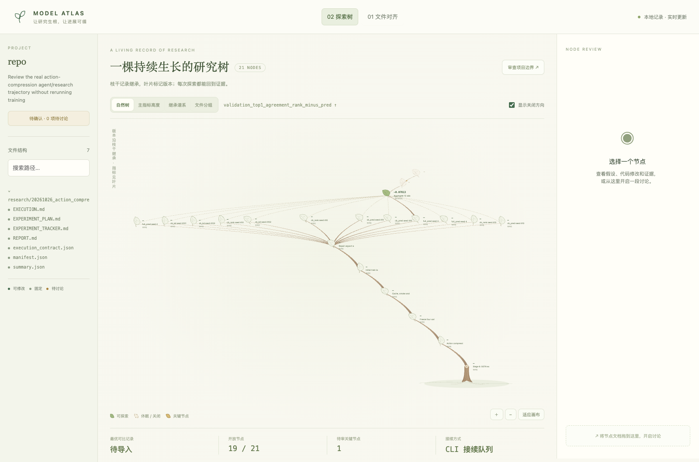

# Real agent/RSI trajectory ingestion

`mih explore import-trajectory` projects a privacy-reviewed, hash-pinned research
trajectory into the explorer without pretending that mih executed the historical
runs. It keeps three layers distinct:

1. Git lineage: source and evidence revisions.
2. Agent/research lineage: proposal, contract, review, verdict and next decision.
3. Runtime lineage: attempts, failures, repairs, per-seed runs and aggregation.

The trajectory unit is therefore `proposal → frozen contract → attempt(s) →
aggregation → verdict → next decision`, not “one Git commit equals one experiment.”

## Bundle and assurance boundary

The JSON bundle has a stable `trajectory_id`, a pinned `source.revision`, and a
topologically ordered `events` array. Each event declares a stable ID, kind,
parents, status, optional primary metric, metadata, and an explicit artifact list:

```json
{
  "schema_version": 1,
  "trajectory_id": "project-method-20261026",
  "source": {"repository": "/checkout", "revision": "FULL_GIT_SHA", "anchor": "FULL_GIT_SHA"},
  "events": [{
    "id": "failed-launch",
    "kind": "attempt",
    "title": "Initial launch failed before optimizer update",
    "parents": ["git:anchor"],
    "status": "failed",
    "artifacts": [{"path": "research/run/EXECUTION.md", "sha256": "...", "role": "execution_record"}]
  }]
}
```

Supported kinds are `proposal`, `contract`, `attempt`, `run`, `aggregate`,
`review`, `verdict`, and `decision`. The importer:

- resolves the exact Git commit and reads artifact blobs from that commit, not
  from a possibly dirty worktree;
- verifies every SHA-256, archives the selected bytes in controller state, and is
  deterministic/idempotent for stable trajectory/event IDs;
- rejects traversal, credential-looking files and bundle keys containing secrets,
  tokens, cookies, credentials or raw prompt/response/conversation data;
- caps a bundle at 2 MiB, each artifact at 2 MiB, all artifacts at 10 MiB, and a
  trajectory at 1000 events;
- labels every node `hash-verified archival trajectory; not mih runtime
  acceptance`.

This creates three visible trust levels: Git-only history, hash-verified archival
trajectory, and `attach-run` runtime-trusted experiments. Only the last level has
been revalidated against the mih runtime and frozen scorer.

```bash
PYTHONPATH=src python3 -m mih --state STATE explore import-trajectory \
  TREE_ID --bundle trajectory.bundle.json
```

## `subspace_cem` real pilot

The adapter [import_subspace_cem.py](../examples/import_subspace_cem.py) reads the
public `research/20261026_action_compression` package and builds a 20-node
trajectory: plan, contract, cache/smoke/pilot, preserved failed `argsort` launch,
repair, 4 variants × 3 seeds, aggregate, verdict, and the no-post-hoc-tuning
decision.

```bash
git clone --depth 1 --branch subspace_cem \
  https://github.com/yuanxiang02/subspace_cem.git /tmp/subspace_cem
PYTHONPATH=src python3 examples/import_subspace_cem.py \
  --repository /tmp/subspace_cem --root /tmp/subspace_cem_mih
```

The 2026-11-11 pilot pinned revision `dd333b629123882427158fa55e0c17d896362c0a`.
It produced one Git node plus 20 archival nodes and archived seven allowlisted
evidence files. No model call, remote connection, or training rerun was used.



### Evidence review

Raw aggregate validation table (lower is better for the three loss columns;
higher is better for agreement/recall):

| Variant | Prediction MSE | Teacher MSE | Top-1 agreement | Top-2 recall | Pairwise KL |
|---|---:|---:|---:|---:|---:|
| `full_pred` | 0.01783 | 0.00028 | 0.94271 | 0.96484 | 0.01112 |
| `cb_pred` | 0.08120 | 0.06871 | 0.36979 | 0.59635 | 3.55881 |
| `cb_kd` | 0.08127 | 0.06852 | 0.36458 | 0.59635 | 3.46925 |
| `cb_rank` | 0.10613 | 0.09384 | 0.29167 | 0.59115 | 2.13292 |

- Primary C1 contrast, validation top-1 agreement `cb_rank − cb_pred`: `-0.078125`,
  95% CI `[-0.161458, 0.005208]`. It misses the prespecified `+0.05` gate.
- Exploratory physical round-1 regret contrast: `-0.061470`, 95% CI
  `[-0.143656, 0.030820]`; the interval crosses zero.
- Pairwise KL improves by `-1.425891`, CI `[-2.787726, -0.416572]`, but prediction
  MSE worsens by `+0.024935`, CI `[0.017198, 0.033187]`. The rank objective learns
  its direct local surrogate without transferring to the prespecified teacher
  top-1 preservation claim. Both recorded efficacy decisions are unsupported.
- The adapter saves a `changes_requested` review and agent-closes this frozen
  branch without extra seeds or loss-weight tuning. A materially different future
  hypothesis should be a new branch, not a rewrite of this negative result.

Candidate next branches, each requiring a new frozen contract, are: a
state-conditioned bottleneck rather than another rank-weight sweep; a physically
aligned objective using train-source labels with explicit leakage controls; and a
student-driven closed-loop CEM evaluation after the development signal is strong
enough. Independent end-to-end teacher repetitions would be needed before making
a general training-robustness claim because the current three seeds are adaptation
seeds sharing one teacher.

The boundary intentionally remains unapproved after archival import. Reading,
discussion, review and closing are allowed; continuation or new training still
requires a human to acknowledge the exact current file boundary.

## Product review and remaining gaps

The pilot proves that real repository evidence can form a complete, reviewable
tree and preserve a failure rather than flattening it into a paper result. It does
not yet prove live agent observability.

Highest-priority gaps:

1. Add native emitters in agent runtimes so proposal, tool call, patch, run ID,
   review and next-decision events arrive incrementally instead of through a
   repository-specific adapter.
2. Show trust badges and artifact-hash drill-downs directly in the UI; today the
   distinction is present in node evidence but too easy to miss.
3. Add a trajectory-focused view. Metric height is intentionally sparse for this
   pilot because only the aggregate owns the prespecified primary contrast.
4. Capture environment/container identity, scheduler job ID, exit code and raw-log
   hashes in a standard execution envelope. The public package records much of
   this in prose, not one common schema.
5. Add consent-aware redaction reports and stable actor/session pseudonyms so
   private agent traces can be imported without copying conversations.
6. Support explicit links from an archival node to a later `attach-run`
   reproduction, preserving both the historical claim and independently trusted
   rerun.

