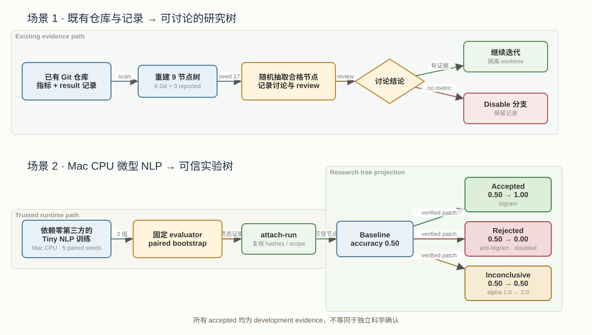
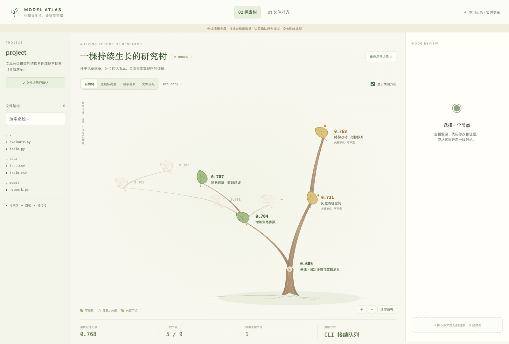
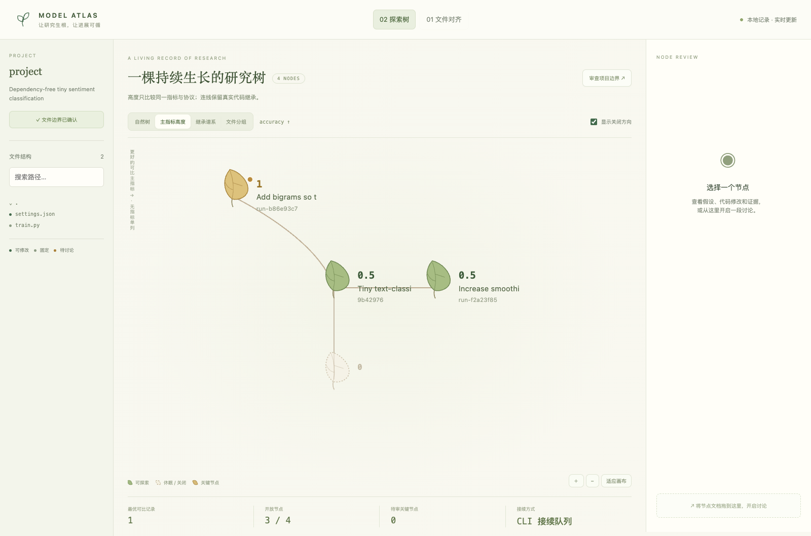

# Trusted experiment to research-tree closure

`mih explore attach-run` is the authority bridge between the experiment runtime
and the research explorer. It projects verified runtime evidence into a tree;
`explore record` remains the separate path for untrusted reported observations.



```bash
mih --state STATE explore attach-run TREE_ID PARENT_NODE \
  --experiment EXP_ID
```

The command requires an acknowledged current tree boundary and a completed mih
acceptance record. Before creating a node it rechecks:

- the frozen contract, inputs, reference, evaluator, source snapshots and project review;
- the experiment repository and selected parent baseline;
- metric name and direction;
- the candidate patch digest and every changed file against the reviewed mutable surface;
- finite baseline/candidate means and an accepted, rejected or inconclusive verdict.

The resulting `run-<experiment>` node stores the experiment ID, runtime status,
contract/measurement/acceptance/patch hashes and development-assurance label.
The selected Git parent receives the trusted baseline mean. Repeating the same
attachment is idempotent; another parent, boundary revision or patch conflicts.

Continuing from an attached experiment materializes its baseline commit and then
applies the verified candidate patch. This makes discussion and further code work
start from the evaluated candidate rather than silently falling back to its Git
baseline. The next training run still needs the reviewed project lifecycle; the
runtime does not yet support arbitrary candidate-as-baseline statistical ancestry.

## Reproducible closure scenarios

The runner exercises both intended product paths without model API calls:

```bash
python examples/run_closure_scenarios.py \
  --root /new/output/directory \
  --scenario all \
  --history-source /existing/explorer/demo \
  --seed 17
```

The history scenario reads an existing Git repository plus retained metric/result
records, rebuilds a fresh nine-node tree, deterministically samples eligible nodes,
records discussions, continues one in an isolated workspace and disables the other.
It does not mutate the source repository.

The NLP scenario creates a dependency-free multinomial Naive Bayes text task,
reviews project and tree boundaries as explicitly simulated fixtures, and runs
three real CPU candidates through frozen paired scoring. It expects one accepted,
one rejected and one inconclusive result, attaches all three as trusted sibling
nodes, reviews them and disables the rejected direction. The original training
repository remains clean.

These are development demonstrations on synthetic data. A runtime acceptance is
stronger than an imported score, but it is not independent confirmation of model
quality and the simulated acknowledgments are not user authorization.

## Captured results

Existing-history tree rebuilt from retained records:



Trusted tiny-NLP candidates projected by primary metric:


